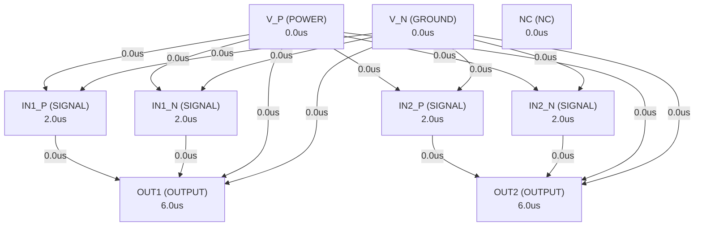

# Autonomous AI Analog Circuit Synthesis & Verification Report
**Target IC:** `LM358B` | **Subcircuit:** `LM358B`
**Overall Datasheet Specification Pass Rate (among measured specs):** `0.0%`
**Measurement Coverage (measured / testable specs):** `0.0%`

## 1. Executive Summary
- **IC Category:** Industry-Standard Dual Operational Amplifiers with wide supply range of 3V to 36V, unity-gain bandwidth of 1.2MHz, and internal RF and EMI filter.
- **Total Datasheet Specifications Extracted:** 155
- **Design Iterations Required:** 15
- **Synthesized Netlist Location:** `/mnt/d/예캡/runs/20261123_010848_lm358_1/harness/LM358B_FINAL_HERMES_HARNESS2.cir`

## 2. Port Dependency Graph (PDG) Scheduling
Topological activation sequence derived from physical pin roles:
| Pin Name | Physical Role | Direction | Activation Time (us) |
| :--- | :--- | :--- | :--- |
| `IN1_P` | `SIGNAL` | `INPUT` | 2.00 us |
| `IN1_N` | `SIGNAL` | `INPUT` | 2.00 us |
| `IN2_P` | `SIGNAL` | `INPUT` | 2.00 us |
| `IN2_N` | `SIGNAL` | `INPUT` | 2.00 us |
| `OUT1` | `OUTPUT` | `OUTPUT` | 6.00 us |
| `OUT2` | `OUTPUT` | `OUTPUT` | 6.00 us |
| `V_P` | `POWER` | `POWER` | 0.00 us |
| `V_N` | `GROUND` | `GROUND` | 0.00 us |
| `NC` | `NC` | `NC` | 0.00 us |

### 2.1 Port Dependency Graph Topology


## 3. Specification Verification & SymPy Oracle Audit
Detailed verification results evaluated against SymPy interval constraints:
| Parameter | Min Target | Typ Target | Max Target | Measured Value | Unit | Status |
| :--- | :--- | :--- | :--- | :--- | :--- | :--- |
| `TA` | - | - | - | **N/A** | °C | ❌ FAIL |
| `VOS` | 0.0003 | - | 0.003 | **N/A** | V | ❌ FAIL |
| `VOS` | 0.0003 | - | 0.003 | **N/A** | V | ❌ FAIL |
| `VOS` | 0.0004 | - | - | **N/A** | V | ❌ FAIL |
| `VOS` | 0.0004 | - | - | **N/A** | V | ❌ FAIL |
| `dVOS/dT` | - | - | - | **N/A** | µV/°C | ❌ FAIL |
| `PSRR` | - | 96.48 | - | **N/A** | dB | ❌ FAIL |
| `CMRR` | - | 80 | - | **N/A** | dB | ❌ FAIL |
| `CMRR` | - | 70.01 | - | **N/A** | dB | ❌ FAIL |
| `IB` | -1e-08 | -3.5e-08 | - | **N/A** | A | ❌ FAIL |
| `IOS` | 5e-10 | 4e-09 | - | **N/A** | A | ❌ FAIL |
| `dIOS/dT` | - | - | - | **N/A** | pA/℃ | ❌ FAIL |
| `En` | - | - | - | **N/A** | µVPP | ❌ FAIL |
| `en` | - | - | - | **N/A** | nV/rtHz | ❌ FAIL |
| `ZID` | - | - | - | **N/A** | MΩ|| pF | ❌ FAIL |
| `ZIC` | - | - | - | **N/A** | GΩ|| pF | ❌ FAIL |
| `AOL` | - | - | - | **N/A** | dB | ❌ FAIL |
| `GBW` | 1.2e+06 | - | - | **N/A** | Hz | ❌ FAIL |
| `SR` | 0.5 | - | - | **N/A** | V/us | ❌ FAIL |
| `Θm` | 56 | - | - | **N/A** | deg | ❌ FAIL |
| `tOR` | - | - | - | **N/A** | µs | ❌ FAIL |
| `ts` | - | - | - | **N/A** | µs | ❌ FAIL |
| `THD+N` | - | - | - | **N/A** | % | ❌ FAIL |
| `VO` | 1.35 | 1.42 | - | **N/A** | V | ❌ FAIL |
| `VO` | 1.4 | 1.48 | - | **N/A** | V | ❌ FAIL |
| `VO` | 1.5 | 1.61 | - | **N/A** | V | ❌ FAIL |
| `VO` | 0.1 | 0.15 | - | **N/A** | V | ❌ FAIL |
| `VO` | 0.75 | 1 | - | **N/A** | V | ❌ FAIL |
| `IO` | -0.02 | -0.03 | - | **N/A** | A | ❌ FAIL |
| `IO` | -0.01 | -0.02 | - | **N/A** | A | ❌ FAIL |
| `IO` | 6e-05 | 0.0001 | - | **N/A** | A | ❌ FAIL |
| `ISC` | -0.04 | -0.06 | - | **N/A** | A | ❌ FAIL |
| `CLOAD` | - | - | - | **N/A** | pF | ❌ FAIL |
| `RO` | - | - | - | **N/A** | Ω | ❌ FAIL |
| `IQ` | 0.0003 | 0.00046 | - | **N/A** | A | ❌ FAIL |
| `IQ` | 0.0008 | - | - | **N/A** | A | ❌ FAIL |
| `VOS` | 0.0003 | - | 0.003 | **N/A** | V | ❌ FAIL |
| `VOS` | 0.002 | - | - | **N/A** | V | ❌ FAIL |
| `dVOS/dT` | - | - | - | **N/A** | µV/°C | ❌ FAIL |
| `PSRR` | - | 96.48 | - | **N/A** | dB | ❌ FAIL |
| `CMRR` | - | 80 | - | **N/A** | dB | ❌ FAIL |
| `CMRR` | - | 70.01 | - | **N/A** | dB | ❌ FAIL |
| `IB` | -1e-08 | -3.5e-08 | - | **N/A** | A | ❌ FAIL |
| `IOS` | 5e-10 | 4e-09 | - | **N/A** | A | ❌ FAIL |
| `dIOS/dT` | - | - | - | **N/A** | pA/℃ | ❌ FAIL |
| `ts` | - | - | - | **N/A** | µs | ❌ FAIL |
| `VO` | 1.35 | 1.42 | - | **N/A** | V | ❌ FAIL |
| `VO` | 1.4 | 1.48 | - | **N/A** | V | ❌ FAIL |
| `VO` | 1.5 | 1.61 | - | **N/A** | V | ❌ FAIL |
| `VO` | 0.1 | 0.15 | - | **N/A** | V | ❌ FAIL |
| `VO` | 0.75 | 1 | - | **N/A** | V | ❌ FAIL |
| `IO` | -0.02 | -0.03 | - | **N/A** | A | ❌ FAIL |
| `IO` | -0.01 | -0.02 | - | **N/A** | A | ❌ FAIL |
| `ISC` | 6e-05 | 0.0001 | - | **N/A** | A | ❌ FAIL |
| `IQ` | 0.0008 | - | - | **N/A** | A | ❌ FAIL |
| `VOS` | 0.003 | 0.007 | 0.011 | **N/A** | V | ❌ FAIL |
| `dVOS/dT` | - | - | - | **N/A** | µV/°C | ❌ FAIL |
| `dVOS/dT` | - | - | - | **N/A** | µV/°C | ❌ FAIL |
| `PSRR` | - | - | - | **N/A** | V | ❌ FAIL |
| `VO1/ VO2` | - | - | - | **N/A** | dB | ❌ FAIL |
| `VCM` | - | - | - | **N/A** | V | ❌ FAIL |
| `VCM` | - | - | - | **N/A** | V | ❌ FAIL |
| `CMRR` | 65 | 80 | - | **N/A** | dB | ❌ FAIL |
| `IB` | -2e-08 | -2.5e-07 | -5e-07 | **N/A** | A | ❌ FAIL |
| `IB` | -1.5e-08 | -1e-07 | -2e-07 | **N/A** | A | ❌ FAIL |
| `IOS` | 2e-09 | 5e-08 | 1.5e-07 | **N/A** | A | ❌ FAIL |
| `IOS` | 2e-09 | 3e-08 | 7.5e-08 | **N/A** | A | ❌ FAIL |
| `dIOS/dT` | - | - | - | **N/A** | pA/°C | ❌ FAIL |
| `AOL` | 87.96 | 100 | - | **N/A** | dB | ❌ FAIL |
| `GBW` | 7e+05 | - | - | **N/A** | Hz | ❌ FAIL |
| `SR` | 0.3 | - | - | **N/A** | V/us | ❌ FAIL |
| `VO` | 4 | - | - | **N/A** | V | ❌ FAIL |
| `VO` | 2 | 3 | - | **N/A** | V | ❌ FAIL |
| `VO` | 1.5 | - | - | **N/A** | V | ❌ FAIL |
| `VO` | 0.005 | 0.02 | - | **N/A** | V | ❌ FAIL |
| `IO` | -0.02 | - | -0.03 | **N/A** | A | ❌ FAIL |
| `IO` | -0.06 | - | -0.01 | **N/A** | A | ❌ FAIL |
| `IO` | 5e-06 | 1.2e-05 | 3e-05 | **N/A** | A | ❌ FAIL |
| `ISC` | 0.04 | - | 0.06 | **N/A** | A | ❌ FAIL |
| `IQ` | 0.00035 | 0.0006 | - | **N/A** | A | ❌ FAIL |
| `IQ` | 0.0005 | 0.001 | - | **N/A** | A | ❌ FAIL |
| `VOS` | 0.003 | 0.007 | - | **N/A** | V | ❌ FAIL |
| `VOS` | 0.001 | 0.002 | - | **N/A** | V | ❌ FAIL |
| `VOS` | 0.004 | - | - | **N/A** | V | ❌ FAIL |
| `dVOS/dT` | - | - | - | **N/A** | µV/°C | ❌ FAIL |
| `VCM` | - | - | - | **N/A** | V | ❌ FAIL |
| `VCM` | - | - | - | **N/A** | V | ❌ FAIL |
| `CMRR` | 65 | 80 | - | **N/A** | dB | ❌ FAIL |
| `IB` | -2e-08 | -2.5e-07 | - | **N/A** | A | ❌ FAIL |
| `IOS` | 2e-09 | 5e-08 | - | **N/A** | A | ❌ FAIL |
| `IOS` | 2e-09 | 5e-08 | - | **N/A** | A | ❌ FAIL |
| `dIOS/dT` | - | - | - | **N/A** | pA/°C | ❌ FAIL |
| `AOL` | - | - | - | **N/A** | dB | ❌ FAIL |
| `GBW` | 7e+05 | - | - | **N/A** | Hz | ❌ FAIL |
| `VO` | - | - | - | **N/A** | V | ❌ FAIL |
| `VO` | - | - | 2 | **N/A** | V | ❌ FAIL |
| `VO` | - | - | 6 | **N/A** | V | ❌ FAIL |
| `VO` | - | - | 4 | **N/A** | V | ❌ FAIL |
| `VO` | 0.005 | 0.02 | - | **N/A** | V | ❌ FAIL |
| `IO` | -0.02 | -0.03 | - | **N/A** | A | ❌ FAIL |
| `IO` | -0.01 | - | - | **N/A** | A | ❌ FAIL |
| `IO` | 3e-05 | - | - | **N/A** | A | ❌ FAIL |
| `IO` | 1.2e-05 | - | - | **N/A** | A | ❌ FAIL |
| `ISC` | - | - | - | **N/A** | A | ❌ FAIL |
| `VOS` | 0.003 | 0.005 | - | **N/A** | V | ❌ FAIL |
| `VOS` | 0.007 | - | - | **N/A** | V | ❌ FAIL |
| `dVOS/dT` | - | - | - | **N/A** | µV/°C | ❌ FAIL |
| `dVOS/dT` | - | - | - | **N/A** | µV/°C | ❌ FAIL |
| `VCM` | - | - | - | **N/A** | V | ❌ FAIL |
| `VCM` | - | - | - | **N/A** | V | ❌ FAIL |
| `CMRR` | 70 | 80 | - | **N/A** | dB | ❌ FAIL |
| `IB` | -2e-08 | -1.5e-07 | - | **N/A** | A | ❌ FAIL |
| `IB` | -3e-07 | - | - | **N/A** | A | ❌ FAIL |
| `IOS` | 2e-09 | 3e-08 | - | **N/A** | A | ❌ FAIL |
| `IOS` | 2e-09 | 1e-08 | - | **N/A** | A | ❌ FAIL |
| `dIOS/dT` | - | - | - | **N/A** | pA/°C | ❌ FAIL |
| `AOL` | 93.98 | 100 | - | **N/A** | dB | ❌ FAIL |
| `GBW` | 7e+05 | - | - | **N/A** | Hz | ❌ FAIL |
| `VO` | 4 | - | - | **N/A** | V | ❌ FAIL |
| `VO` | 0.005 | - | 0.02 | **N/A** | V | ❌ FAIL |
| `IO` | -0.02 | -0.03 | - | **N/A** | A | ❌ FAIL |
| `IO` | -0.06 | - | - | **N/A** | A | ❌ FAIL |
| `IO` | 0.01 | 0.02 | - | **N/A** | A | ❌ FAIL |
| `IO` | 5e-06 | - | - | **N/A** | A | ❌ FAIL |
| `ISC` | -0.04 | -0.06 | - | **N/A** | A | ❌ FAIL |
| `IQ` | 0.00035 | 0.0006 | - | **N/A** | A | ❌ FAIL |
| `IQ` | 0.0005 | - | 0.001 | **N/A** | A | ❌ FAIL |
| `VOS` | 0.003 | 0.005 | - | **N/A** | V | ❌ FAIL |
| `VOS` | 0.002 | 0.003 | - | **N/A** | V | ❌ FAIL |
| `dVOS/dT` | - | - | - | **N/A** | µV/°C | ❌ FAIL |
| `dVOS/dT` | - | - | - | **N/A** | µV/°C | ❌ FAIL |
| `PSRR` | - | - | - | **N/A** | V | ❌ FAIL |
| `VO1/ VO2` | - | - | - | **N/A** | dB | ❌ FAIL |
| `VCM` | - | - | - | **N/A** |  | ❌ FAIL |
| `VCM` | - | - | - | **N/A** |  | ❌ FAIL |
| `CMRR` | 70 | 80 | - | **N/A** | dB | ❌ FAIL |
| `IB` | -2e-08 | -1.5e-07 | - | **N/A** | A | ❌ FAIL |
| `IB` | -3e-07 | - | - | **N/A** | A | ❌ FAIL |
| `IOS` | 2e-09 | 3e-08 | - | **N/A** | A | ❌ FAIL |
| `IOS` | 2e-09 | 1.5e-08 | - | **N/A** | A | ❌ FAIL |
| `dIOS/dT` | - | - | - | **N/A** | pA/°C | ❌ FAIL |
| `dIOS/dT` | - | - | - | **N/A** | pA/°C | ❌ FAIL |
| `en` | - | - | - | **N/A** | nV/rtHz | ❌ FAIL |
| `GBW` | - | 7e+05 | - | **N/A** | Hz | ❌ FAIL |
| `SR` | - | 0.3 | - | **N/A** | V/us | ❌ FAIL |
| `VO` | 4 | - | - | **N/A** | V | ❌ FAIL |
| `VO` | 2 | 3 | - | **N/A** | V | ❌ FAIL |
| `VO` | 1.5 | - | - | **N/A** | V | ❌ FAIL |
| `VO` | 0.005 | 0.02 | - | **N/A** | V | ❌ FAIL |
| `IO` | -0.02 | -0.03 | - | **N/A** | A | ❌ FAIL |
| `IO` | -0.06 | - | - | **N/A** | A | ❌ FAIL |
| `IO` | 5e-06 | - | - | **N/A** | A | ❌ FAIL |
| `ISC` | -0.04 | - | -0.06 | **N/A** | A | ❌ FAIL |
| `IQ` | 0.00035 | - | 0.0006 | **N/A** | A | ❌ FAIL |
| `IQ` | 0.0005 | - | 0.001 | **N/A** | A | ❌ FAIL |
| `THD+N` | 0.001 | - | - | **N/A** | % | ❌ FAIL |
| `VO1/ VO2` | 120 | - | - | **N/A** | dB | ❌ FAIL |
| `VO1/ VO2` | 120 | - | - | **N/A** | dB | ❌ FAIL |

## 4. Closed-Loop Iteration History & Root Cause Analysis
| Iteration | Pass Rate | Passed Specs | Failed Specs | Architecture Notes |
| :--- | :--- | :--- | :--- | :--- |
| Iteration 1 | 0.0% | 0 | 3 | Hermes Autonomous Synthesis (Workspace: /mnt/d/예캡/runs/20261123_010848_lm358_1/h... |
| Iteration 2 | 0.0% | 0 | 3 | Hermes Autonomous Synthesis (Workspace: /mnt/d/예캡/runs/20261123_010848_lm358_1/h... |
| Iteration 3 | 0.0% | 0 | 3 | Hermes Autonomous Synthesis (Workspace: /mnt/d/예캡/runs/20261123_010848_lm358_1/h... |
| Iteration 4 | 0.0% | 0 | 3 | Hermes Autonomous Synthesis (Workspace: /mnt/d/예캡/runs/20261123_010848_lm358_1/h... |
| Iteration 5 | 0.0% | 0 | 3 | Hermes Autonomous Synthesis (Workspace: /mnt/d/예캡/runs/20261123_010848_lm358_1/h... |
| Iteration 6 | 0.0% | 0 | 3 | Hermes Autonomous Synthesis (Workspace: /mnt/d/예캡/runs/20261123_010848_lm358_1/h... |
| Iteration 7 | 0.0% | 0 | 3 | Hermes Autonomous Synthesis (Workspace: /mnt/d/예캡/runs/20261123_010848_lm358_1/h... |
| Iteration 8 | 0.0% | 0 | 3 | Hermes Autonomous Synthesis (Workspace: /mnt/d/예캡/runs/20261123_010848_lm358_1/h... |
| Iteration 9 | 0.0% | 0 | 3 | Hermes Autonomous Synthesis (Workspace: /mnt/d/예캡/runs/20261123_010848_lm358_1/h... |
| Iteration 10 | 0.0% | 0 | 3 | Hermes Autonomous Synthesis (Workspace: /mnt/d/예캡/runs/20261123_010848_lm358_1/h... |
| Iteration 11 | 0.0% | 0 | 3 | Hermes Autonomous Synthesis (Workspace: /mnt/d/예캡/runs/20261123_010848_lm358_1/h... |
| Iteration 12 | 0.0% | 0 | 3 | Hermes Autonomous Synthesis (Workspace: /mnt/d/예캡/runs/20261123_010848_lm358_1/h... |
| Iteration 13 | 0.0% | 0 | 3 | Hermes Autonomous Synthesis (Workspace: /mnt/d/예캡/runs/20261123_010848_lm358_1/h... |
| Iteration 14 | 0.0% | 0 | 3 | Hermes Autonomous Synthesis (Workspace: /mnt/d/예캡/runs/20261123_010848_lm358_1/h... |
| Iteration 15 | 0.0% | 0 | 3 | Hermes Autonomous Synthesis (Workspace: /mnt/d/예캡/runs/20261123_010848_lm358_1/h... |

### 4.1 Loop 1 Detailed Audit
- **Pass Rate**: `0.0%` (0/3 specs passed)

**Shortfall Audit (미달 원인 분석):**
- None (All specifications and compilation checks passed).

**Improvement Actions (개선 및 수정 사항):**
- Hermes Agent Turn 1: Executed tools ['retrieve_subcircuit_blueprint']

### 4.2 Loop 2 Detailed Audit
- **Pass Rate**: `0.0%` (0/3 specs passed)

**Shortfall Audit (미달 원인 분석):**
- None (All specifications and compilation checks passed).

**Improvement Actions (개선 및 수정 사항):**
- Hermes Agent Turn 2: Executed tools ['retrieve_subcircuit_blueprint']

### 4.3 Loop 3 Detailed Audit
- **Pass Rate**: `0.0%` (0/3 specs passed)

**Shortfall Audit (미달 원인 분석):**
- None (All specifications and compilation checks passed).

**Improvement Actions (개선 및 수정 사항):**
- Hermes Agent Turn 3: Executed tools []

### 4.4 Loop 4 Detailed Audit
- **Pass Rate**: `0.0%` (0/3 specs passed)

**Shortfall Audit (미달 원인 분석):**
- None (All specifications and compilation checks passed).

**Improvement Actions (개선 및 수정 사항):**
- Hermes Agent Turn 4: Executed tools []

### 4.5 Loop 5 Detailed Audit
- **Pass Rate**: `0.0%` (0/3 specs passed)

**Shortfall Audit (미달 원인 분석):**
- None (All specifications and compilation checks passed).

**Improvement Actions (개선 및 수정 사항):**
- Hermes Agent Turn 5: Executed tools []

### 4.6 Loop 6 Detailed Audit
- **Pass Rate**: `0.0%` (0/3 specs passed)

**Shortfall Audit (미달 원인 분석):**
- None (All specifications and compilation checks passed).

**Improvement Actions (개선 및 수정 사항):**
- Hermes Agent Turn 6: Executed tools []

### 4.7 Loop 7 Detailed Audit
- **Pass Rate**: `0.0%` (0/3 specs passed)

**Shortfall Audit (미달 원인 분석):**
- None (All specifications and compilation checks passed).

**Improvement Actions (개선 및 수정 사항):**
- Hermes Agent Turn 7: Executed tools []

### 4.8 Loop 8 Detailed Audit
- **Pass Rate**: `0.0%` (0/3 specs passed)

**Shortfall Audit (미달 원인 분석):**
- None (All specifications and compilation checks passed).

**Improvement Actions (개선 및 수정 사항):**
- Hermes Agent Turn 8: Executed tools ['verify_circuit_pdg_gate']

### 4.9 Loop 9 Detailed Audit
- **Pass Rate**: `0.0%` (0/3 specs passed)

**Shortfall Audit (미달 원인 분석):**
- None (All specifications and compilation checks passed).

**Improvement Actions (개선 및 수정 사항):**
- Hermes Agent Turn 9: Executed tools []

### 4.10 Loop 10 Detailed Audit
- **Pass Rate**: `0.0%` (0/3 specs passed)

**Shortfall Audit (미달 원인 분석):**
- None (All specifications and compilation checks passed).

**Improvement Actions (개선 및 수정 사항):**
- Hermes Agent Turn 10: Executed tools []

### 4.11 Loop 11 Detailed Audit
- **Pass Rate**: `0.0%` (0/3 specs passed)

**Shortfall Audit (미달 원인 분석):**
- None (All specifications and compilation checks passed).

**Improvement Actions (개선 및 수정 사항):**
- Hermes Agent Turn 11: Executed tools ['verify_circuit_pdg_gate']

### 4.12 Loop 12 Detailed Audit
- **Pass Rate**: `0.0%` (0/3 specs passed)

**Shortfall Audit (미달 원인 분석):**
- None (All specifications and compilation checks passed).

**Improvement Actions (개선 및 수정 사항):**
- Hermes Agent Turn 12: Executed tools []

### 4.13 Loop 13 Detailed Audit
- **Pass Rate**: `0.0%` (0/3 specs passed)

**Shortfall Audit (미달 원인 분석):**
- None (All specifications and compilation checks passed).

**Improvement Actions (개선 및 수정 사항):**
- Hermes Agent Turn 13: Executed tools []

### 4.14 Loop 14 Detailed Audit
- **Pass Rate**: `0.0%` (0/3 specs passed)

**Shortfall Audit (미달 원인 분석):**
- None (All specifications and compilation checks passed).

**Improvement Actions (개선 및 수정 사항):**
- Hermes Agent Turn 14: Executed tools []

### 4.15 Loop 15 Detailed Audit
- **Pass Rate**: `0.0%` (0/3 specs passed)

**Shortfall Audit (미달 원인 분석):**
- None (All specifications and compilation checks passed).

**Improvement Actions (개선 및 수정 사항):**
- Hermes Agent Turn 15: Executed tools []

## 5. Synthesized SPICE Netlist Architecture
Netlist file: `/mnt/d/예캡/runs/20261123_010848_lm358_1/harness/LM358B_FINAL_HERMES_HARNESS2.cir`
```spice
.subckt LM358B IN1_P IN1_N IN2_P IN2_N OUT1 OUT2 V_P V_N NC
* Differential Pair Stage 1
M1 IN1_P IN1_N V_P V_N nfet_06v0_bsim0 W=10u L=0.5u
M2 IN1_P IN1_N V_P V_N pfet_06v0_bsim0 W=10u L=0.5u
M3 IN2_P IN2_N V_P V_N nfet_06v0_bsim0 W=10u L=0.5u
M4 IN2_P IN2_N V_P V_N pfet_06v0_bsim0 W=10u L=0.5u
* Active Load Stage 1
MNM1 V_P OUT1 V_P NMN NMN nfet_06v0_bsim0 W=20u L=0.5u
MNM2 V_P OUT1 V_N NMN NMN pfet_06v0_bsim0 W=20u L=0.5u
* Differential Pair Stage 2
M5 IN1_P IN2_P V_P V_N nfet_06v0_bsim0 W=10u L=0.5u
M6 IN1_N IN2_N V_P V_N pfet_06v0_bsim0 W=10u L=0.5u
* Two-Stage Gain with Miller Compensation
M7 OUT1 V_P V_N V_P NMN NMN nfet_06v0_bsim0 W=10u L=0.5u
Cc OUT1 OUT2 10p
Rz OUT1 OUT2 2k
M7b OUT2 V_P V_N V_N NMN NMN pfet_06v0_bsim0 W=20u L=0.5u
* Output Buffer Stage 1
MPM1 OUT1 V_P V_N OUT1 V_P MPM MPM nfet_06v0_bsim0 W=10u L=0.5u
MPM2 OUT1 V_P V_N OUT1 V_N MPM MPM pfet_06v0_bsim0 W=10u L=0.5u
* Output Buffer Stage 2
MPM3 OUT2 V_P V_N OUT2 V_P MPM MPM nfet_06v0_bsim0 W=10u L=0.5u
MPM4 OUT2 V_P V_N OUT2 V_N MPM MPM pfet_06v0_bsim0 W=10u L=0.5u
* Explicit Device Models
.model nfet_06v0_bsim0 NMOS (VTO=0.7 KP=100u LAMBDA=0.02)
.model pfet_06v0_bsim0 PMOS (VTO=-0.7 KP=40u LAMBDA=0.02)
.ends LM358B
```