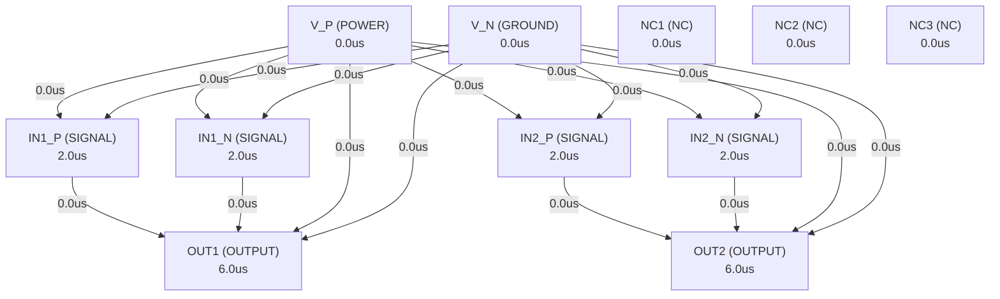

# Autonomous AI Analog Circuit Synthesis & Verification Report
**Target IC:** `LM358` | **Subcircuit:** `LM358`
**Overall Datasheet Specification Pass Rate (among measured specs):** `0.0%`
**Measurement Coverage (measured / testable specs):** `0.0%`

## 1. Executive Summary
- **IC Category:** Industry-Standard Dual Operational Amplifiers
- **Total Datasheet Specifications Extracted:** 203
- **Design Iterations Required:** 10
- **Synthesized Netlist Location:** `/mnt/d/edai_jiyun2/edai/runs/20261123_121857_lm358_1/harness/LM358_HARNESS2_R2.cir`

## 2. Port Dependency Graph (PDG) Scheduling
Topological activation sequence derived from physical pin roles:
| Pin Name | Physical Role | Direction | Activation Time (us) |
| :--- | :--- | :--- | :--- |
| `IN1_P` | `SIGNAL` | `INPUT` | 2.00 us |
| `IN1_N` | `SIGNAL` | `INPUT` | 2.00 us |
| `OUT1` | `OUTPUT` | `OUTPUT` | 6.00 us |
| `IN2_P` | `SIGNAL` | `INPUT` | 2.00 us |
| `IN2_N` | `SIGNAL` | `INPUT` | 2.00 us |
| `OUT2` | `OUTPUT` | `OUTPUT` | 6.00 us |
| `V_P` | `POWER` | `POWER` | 0.00 us |
| `V_N` | `GROUND` | `GROUND` | 0.00 us |
| `NC1` | `NC` | `NC` | 0.00 us |
| `NC2` | `NC` | `NC` | 0.00 us |
| `NC3` | `NC` | `NC` | 0.00 us |

### 2.1 Port Dependency Graph Topology


## 3. Specification Verification & SymPy Oracle Audit
Detailed verification results evaluated against SymPy interval constraints:
| Parameter | Min Target | Typ Target | Max Target | Measured Value | Unit | Status |
| :--- | :--- | :--- | :--- | :--- | :--- | :--- |
| `Vs Supply voltage, Vs= ([V+] - [V-])` | - | - | - | **N/A** | V | ❌ FAIL |
| `Vs Supply voltage, Vs= ([V+] - [V-])` | - | - | - | **N/A** | V | ❌ FAIL |
| `Vs Supply voltage, Vs= ([V+] - [V-])` | - | - | - | **N/A** | V | ❌ FAIL |
| `VCM Common-mode voltage` | - | - | - | **N/A** | V | ❌ FAIL |
| `TA Operating ambient temperature` | - | - | - | **N/A** | °C | ❌ FAIL |
| `TA Operating ambient temperature` | - | - | - | **N/A** | °C | ❌ FAIL |
| `TA Operating ambient temperature` | - | - | - | **N/A** | °C | ❌ FAIL |
| `TA Operating ambient temperature` | - | - | - | **N/A** | °C | ❌ FAIL |
| `TA Operating ambient temperature` | - | - | - | **N/A** | °C | ❌ FAIL |
| `R_BJA` | - | - | - | **N/A** | °C/W | ❌ FAIL |
| `R_BJA` | - | - | - | **N/A** | °C/W | ❌ FAIL |
| `R_BJA` | - | - | - | **N/A** | °C/W | ❌ FAIL |
| `R_BJA` | - | - | - | **N/A** | °C/W | ❌ FAIL |
| `R_BJA` | - | - | - | **N/A** | °C/W | ❌ FAIL |
| `R_BJA` | - | - | - | **N/A** | °C/W | ❌ FAIL |
| `R_BJC(top)` | - | - | - | **N/A** | °C/W | ❌ FAIL |
| `R_BJC(top)` | - | - | - | **N/A** | °C/W | ❌ FAIL |
| `R_BJC(top)` | - | - | - | **N/A** | °C/W | ❌ FAIL |
| `R_BJC(top)` | - | - | - | **N/A** | °C/W | ❌ FAIL |
| `R_BJC(top)` | - | - | - | **N/A** | °C/W | ❌ FAIL |
| `R_BJC(top)` | - | - | - | **N/A** | °C/W | ❌ FAIL |
| `R_BJB` | - | - | - | **N/A** | °C/W | ❌ FAIL |
| `R_BJB` | - | - | - | **N/A** | °C/W | ❌ FAIL |
| `R_BJB` | - | - | - | **N/A** | °C/W | ❌ FAIL |
| `R_BJB` | - | - | - | **N/A** | °C/W | ❌ FAIL |
| `R_BJB` | - | - | - | **N/A** | °C/W | ❌ FAIL |
| `R_BJB` | - | - | - | **N/A** | °C/W | ❌ FAIL |
| `Psi_JT` | - | - | - | **N/A** | °C/W | ❌ FAIL |
| `VOS` | - | 0.0003 | 0.003 | **N/A** | V | ❌ FAIL |
| `VOS` | - | - | 0.004 | **N/A** | V | ❌ FAIL |
| `VOS` | - | - | 0.002 | **N/A** | V | ❌ FAIL |
| `VOS` | - | - | 0.0025 | **N/A** | V | ❌ FAIL |
| `dVOS/dT` | - | - | - | **N/A** | μV/°C | ❌ FAIL |
| `PSRR` | 96.48 | 114 | - | **N/A** | dB | ❌ FAIL |
| `PSRR` | - | - | - | **N/A** | μV/V | ❌ FAIL |
| `VCM` | - | - | - | **N/A** | V | ❌ FAIL |
| `VCM` | - | - | - | **N/A** | V | ❌ FAIL |
| `CMRR` | 80 | 93.98 | - | **N/A** | dB | ❌ FAIL |
| `CMRR` | 70.01 | 92.04 | - | **N/A** | dB | ❌ FAIL |
| `IB` | -1e-08 | -3.5e-08 | - | **N/A** | A | ❌ FAIL |
| `IB` | -5e-08 | - | - | **N/A** | A | ❌ FAIL |
| `IOS` | - | 5e-10 | 4e-09 | **N/A** | A | ❌ FAIL |
| `IOS` | 5e-09 | - | - | **N/A** | A | ❌ FAIL |
| `dlOS/dT` | - | - | - | **N/A** | pA/°C | ❌ FAIL |
| `En` | - | - | - | **N/A** | μVPP | ❌ FAIL |
| `en` | - | - | - | **N/A** | nV/rtHz | ❌ FAIL |
| `ZID` | - | - | - | **N/A** | MΩ|| pF | ❌ FAIL |
| `ZIC` | - | - | - | **N/A** | GΩ|| pF | ❌ FAIL |
| `AOL` | 96.9 | 102.9 | - | **N/A** | dB | ❌ FAIL |
| `AOL` | 90.88 | - | - | **N/A** | dB | ❌ FAIL |
| `GBW` | 1.2e+06 | - | - | **N/A** | Hz | ❌ FAIL |
| `SR` | 0.5 | - | - | **N/A** | V/us | ❌ FAIL |
| `Θm` | 56 | - | - | **N/A** | deg | ❌ FAIL |
| `I_Q` | - | 0.0003 | 0.00046 | **N/A** | A | ❌ FAIL |
| `I_Q` | - | - | 0.0008 | **N/A** | A | ❌ FAIL |
| `VOS` | -0.0003 | 0.003 | - | **N/A** | V | ❌ FAIL |
| `VOS` | - | 0.004 | 0.002 | **N/A** | V | ❌ FAIL |
| `VOS` | - | 0.003 | - | **N/A** | V | ❌ FAIL |
| `dVOS/dT` | - | - | - | **N/A** | μV/°C | ❌ FAIL |
| `PSRR` | - | 96.48 | - | **N/A** | dB | ❌ FAIL |
| `PSRR` | - | - | - | **N/A** | μV/V | ❌ FAIL |
| `VCM` | - | - | - | **N/A** | V | ❌ FAIL |
| `VCM` | - | - | - | **N/A** | V | ❌ FAIL |
| `CMRR` | - | 80 | - | **N/A** | dB | ❌ FAIL |
| `CMRR` | - | - | - | **N/A** | dB | ❌ FAIL |
| `IB` | -1e-08 | -3.5e-08 | - | **N/A** | A | ❌ FAIL |
| `IOS` | - | -5e-08 | - | **N/A** | A | ❌ FAIL |
| `diOS/dT` | - | - | - | **N/A** | nA | ❌ FAIL |
| `En` | - | - | - | **N/A** | μVPP | ❌ FAIL |
| `en` | - | - | - | **N/A** | nV/rtHz | ❌ FAIL |
| `ZID` | - | - | - | **N/A** | MΩ|| pF | ❌ FAIL |
| `ZIC` | - | - | - | **N/A** | GΩ|| pF | ❌ FAIL |
| `AOL` | 96.9 | 102.9 | - | **N/A** | dB | ❌ FAIL |
| `AOL` | 90.88 | - | - | **N/A** | dB | ❌ FAIL |
| `GBW` | 1.2e+06 | - | - | **N/A** | Hz | ❌ FAIL |
| `SR` | 0.5 | - | - | **N/A** | V/us | ❌ FAIL |
| `Θm` | 56 | - | - | **N/A** | deg | ❌ FAIL |
| `tOR` | - | - | - | **N/A** | μs | ❌ FAIL |
| `ts` | - | - | - | **N/A** | μs | ❌ FAIL |
| `THD+N` | - | - | - | **N/A** | % | ❌ FAIL |
| `I_Q` | - | 0.0003 | 0.00046 | **N/A** | A | ❌ FAIL |
| `I_Q` | 0.0008 | - | - | **N/A** | A | ❌ FAIL |
| `VOS` | - | 0.003 | 0.007 | **N/A** | V | ❌ FAIL |
| `VOS` | - | 0.002 | 0.003 | **N/A** | V | ❌ FAIL |
| `dVOS/dT` | - | - | - | **N/A** | μV/°C | ❌ FAIL |
| `dVOS/dT` | - | - | - | **N/A** | μV/°C | ❌ FAIL |
| `PSRR` | - | - | - | **N/A** | V | ❌ FAIL |
| `VOI/VO2` | - | - | - | **N/A** | dB | ❌ FAIL |
| `VCM` | - | - | - | **N/A** | V | ❌ FAIL |
| `VCM` | - | - | - | **N/A** | V | ❌ FAIL |
| `VCM` | - | - | - | **N/A** | V | ❌ FAIL |
| `CMRR` | 65 | 80 | - | **N/A** | dB | ❌ FAIL |
| `IB` | -2e-08 | -2.5e-07 | - | **N/A** | A | ❌ FAIL |
| `IB` | - | -5e-07 | - | **N/A** | A | ❌ FAIL |
| `IB` | -1.5e-08 | -1e-07 | - | **N/A** | A | ❌ FAIL |
| `IB` | - | -2e-07 | - | **N/A** | A | ❌ FAIL |
| `IOS` | - | 2e-09 | 5e-08 | **N/A** | A | ❌ FAIL |
| `IOS` | - | 1.5e-07 | - | **N/A** | A | ❌ FAIL |
| `IOS` | - | 2e-09 | 3e-08 | **N/A** | A | ❌ FAIL |
| `IOS` | - | 7.5e-08 | - | **N/A** | A | ❌ FAIL |
| `dlOS/dT` | - | - | - | **N/A** | pA/°C | ❌ FAIL |
| `eη` | - | - | - | **N/A** | nV/rtHz | ❌ FAIL |
| `AOL` | 87.96 | 100 | - | **N/A** | dB | ❌ FAIL |
| `AOL` | 83.52 | - | - | **N/A** | dB | ❌ FAIL |
| `GBW` | 7e+05 | - | - | **N/A** | Hz | ❌ FAIL |
| `SR` | 0.3 | - | - | **N/A** | V/us | ❌ FAIL |
| `VO` | - | 4 | - | **N/A** | V | ❌ FAIL |
| `VO` | 2 | 3 | - | **N/A** | V | ❌ FAIL |
| `VO` | - | - | 1.5 | **N/A** | V | ❌ FAIL |
| `VO` | 0.005 | 0.02 | - | **N/A** | V | ❌ FAIL |
| `IO` | -0.02 | -0.03 | - | **N/A** | A | ❌ FAIL |
| `IO` | - | -0.06 | - | **N/A** | A | ❌ FAIL |
| `IO` | -0.01 | - | - | **N/A** | A | ❌ FAIL |
| `IO` | 0.01 | 0.02 | - | **N/A** | A | ❌ FAIL |
| `IO` | 0.005 | - | - | **N/A** | A | ❌ FAIL |
| `IO` | 1.2e-05 | 3e-05 | - | **N/A** | A | ❌ FAIL |
| `ISC` | -0.04 | -0.06 | 0.04 | **N/A** | A | ❌ FAIL |
| `PARAM_117` | - | - | - | **N/A** |  | ❌ FAIL |
| `VOS` | - | 0.003 | 0.007 | **N/A** | V | ❌ FAIL |
| `VOS` | - | 0.01 | - | **N/A** | V | ❌ FAIL |
| `VOS` | - | 0.001 | 0.002 | **N/A** | V | ❌ FAIL |
| `dVOS/dT` | - | - | - | **N/A** | μV/°C | ❌ FAIL |
| `VO1/VO2` | - | - | - | **N/A** | dB | ❌ FAIL |
| `VCM` | - | - | - | **N/A** | V | ❌ FAIL |
| `VCM` | - | - | - | **N/A** | V | ❌ FAIL |
| `CMRR` | 65 | 80 | - | **N/A** | dB | ❌ FAIL |
| `IB` | -2e-08 | - | -2.5e-07 | **N/A** | A | ❌ FAIL |
| `IOS` | - | 2e-09 | 5e-08 | **N/A** | A | ❌ FAIL |
| `IOS` | - | 2e-09 | 5e-08 | **N/A** | A | ❌ FAIL |
| `IOS` | - | - | 1.5e-07 | **N/A** | A | ❌ FAIL |
| `dlOS/dT` | - | - | - | **N/A** | pA/°C | ❌ FAIL |
| `en` | - | - | - | **N/A** | nV/rtHz | ❌ FAIL |
| `AOL` | 87.96 | 100 | - | **N/A** | dB | ❌ FAIL |
| `AOL` | 83.52 | - | - | **N/A** | dB | ❌ FAIL |
| `GBW` | 7e+05 | - | - | **N/A** | Hz | ❌ FAIL |
| `SR` | 0.3 | - | - | **N/A** | V/us | ❌ FAIL |
| `VO` | - | - | - | **N/A** | V | ❌ FAIL |
| `VO` | - | - | - | **N/A** | V | ❌ FAIL |
| `VO` | 2 | 3 | - | **N/A** | V | ❌ FAIL |
| `VO` | 6 | 4 | - | **N/A** | V | ❌ FAIL |
| `VO` | 4 | 5 | - | **N/A** | V | ❌ FAIL |
| `VO` | - | 0.005 | 0.02 | **N/A** | V | ❌ FAIL |
| `IO` | -0.02 | -0.03 | - | **N/A** | A | ❌ FAIL |
| `IO` | -0.01 | - | - | **N/A** | A | ❌ FAIL |
| `IO` | 0.01 | 0.02 | - | **N/A** | A | ❌ FAIL |
| `IO` | 0.005 | - | - | **N/A** | A | ❌ FAIL |
| `IO` | 3e-05 | - | - | **N/A** | A | ❌ FAIL |
| `Isc` | - | - | - | **N/A** | A | ❌ FAIL |
| `IQ` | - | 0.00035 | 0.0006 | **N/A** | A | ❌ FAIL |
| `VOS` | 0.003 | 0.005 | 0.007 | **N/A** | V | ❌ FAIL |
| `VOS` | - | - | 0.002 | **N/A** | V | ❌ FAIL |
| `dVOS/dT` | - | - | - | **N/A** | μV/°C | ❌ FAIL |
| `VOI/ VO2` | - | - | - | **N/A** | dB | ❌ FAIL |
| `VCM` | - | - | - | **N/A** | V | ❌ FAIL |
| `VCM` | - | - | - | **N/A** | V | ❌ FAIL |
| `VCM` | - | - | - | **N/A** | V | ❌ FAIL |
| `CMRR` | 70 | 80 | - | **N/A** | dB | ❌ FAIL |
| `IB` | -2e-08 | -1.5e-07 | - | **N/A** | A | ❌ FAIL |
| `IB` | - | -3e-07 | - | **N/A** | A | ❌ FAIL |
| `IB` | -1.5e-08 | -5e-08 | - | **N/A** | A | ❌ FAIL |
| `IB` | - | -1e-07 | - | **N/A** | A | ❌ FAIL |
| `IOS` | - | 2e-09 | 3e-08 | **N/A** | A | ❌ FAIL |
| `IOS` | - | 1e-07 | - | **N/A** | A | ❌ FAIL |
| `IOS` | - | 2e-09 | 1e-08 | **N/A** | A | ❌ FAIL |
| `IOS` | - | 3e-08 | - | **N/A** | A | ❌ FAIL |
| `dlOS/dT` | - | - | - | **N/A** | pA/°C | ❌ FAIL |
| `AOL` | 93.98 | 100 | - | **N/A** | dB | ❌ FAIL |
| `AOL` | 87.96 | - | - | **N/A** | dB | ❌ FAIL |
| `GBW` | 7e+05 | - | - | **N/A** | Hz | ❌ FAIL |
| `VO` | - | - | 4 | **N/A** | V | ❌ FAIL |
| `VO` | 0.005 | 0.02 | - | **N/A** | V | ❌ FAIL |
| `IO` | -0.02 | -0.03 | - | **N/A** | A | ❌ FAIL |
| `IO` | -0.06 | - | - | **N/A** | A | ❌ FAIL |
| `IO` | 0.01 | 0.02 | - | **N/A** | A | ❌ FAIL |
| `IO` | 1.2e-05 | 3e-05 | - | **N/A** | A | ❌ FAIL |
| `I_O` | 0.00035 | 0.0006 | 0.00035 | **N/A** | A | ❌ FAIL |
| `I_O` | - | - | - | **N/A** | A | ❌ FAIL |
| `VOS Input offset voltage` | - | 0.003 | 0.005 | **N/A** | V | ❌ FAIL |
| `VOS Input offset voltage` | 0.007 | - | - | **N/A** | V | ❌ FAIL |
| `VOS Input offset voltage` | - | 0.002 | 0.003 | **N/A** | V | ❌ FAIL |
| `VOS Input offset voltage` | 0.004 | - | - | **N/A** | V | ❌ FAIL |
| `dVOS/dT` | - | - | - | **N/A** | μV/°C | ❌ FAIL |
| `dVOS/dT` | - | - | - | **N/A** | μV/°C | ❌ FAIL |
| `IB` | -2e-08 | -1.5e-07 | - | **N/A** | A | ❌ FAIL |
| `IB` | -3e-07 | - | - | **N/A** | A | ❌ FAIL |
| `IB` | -1.5e-08 | -8e-08 | - | **N/A** | A | ❌ FAIL |
| `IB` | -1e-07 | - | - | **N/A** | A | ❌ FAIL |
| `IOS` | - | 2e-09 | 3e-08 | **N/A** | A | ❌ FAIL |
| `IOS` | 1e-07 | - | - | **N/A** | A | ❌ FAIL |
| `IOS` | - | 2e-09 | 1.5e-08 | **N/A** | A | ❌ FAIL |
| `dlOS/dT` | - | - | - | **N/A** | pA/°C | ❌ FAIL |
| `AOL` | 87.96 | - | - | **N/A** | dB | ❌ FAIL |
| `GBW` | 7e+05 | - | - | **N/A** | Hz | ❌ FAIL |
| `VO` | - | - | 4 | **N/A** | V | ❌ FAIL |
| `VO` | - | - | 2 | **N/A** | V | ❌ FAIL |
| `VO` | 0.005 | 0.02 | - | **N/A** | V | ❌ FAIL |
| `IO` | -0.02 | -0.03 | - | **N/A** | A | ❌ FAIL |
| `IO` | -0.06 | - | - | **N/A** | A | ❌ FAIL |
| `IO` | 0.01 | 0.02 | - | **N/A** | A | ❌ FAIL |
| `IO` | 0.005 | - | - | **N/A** | A | ❌ FAIL |
| `I_SC Short-circuit current` | -0.04 | -0.06 | - | **N/A** | A | ❌ FAIL |
| `IQ` | - | 0.00035 | 0.0006 | **N/A** | A | ❌ FAIL |
| `IQ` | - | 0.0005 | 0.001 | **N/A** | A | ❌ FAIL |

## 4. Closed-Loop Iteration History & Root Cause Analysis
| Iteration | Pass Rate | Passed Specs | Failed Specs | Architecture Notes |
| :--- | :--- | :--- | :--- | :--- |
| Iteration 1 | 0.0% | 0 | 0 | Hermes Autonomous Synthesis (Workspace: /mnt/d/edai_jiyun2/edai/runs/20261123_12... |
| Iteration 2 | 0.0% | 0 | 0 | Hermes Autonomous Synthesis (Workspace: /mnt/d/edai_jiyun2/edai/runs/20261123_12... |
| Iteration 3 | 0.0% | 0 | 0 | Hermes Autonomous Synthesis (Workspace: /mnt/d/edai_jiyun2/edai/runs/20261123_12... |
| Iteration 4 | 0.0% | 0 | 0 | Hermes Autonomous Synthesis (Workspace: /mnt/d/edai_jiyun2/edai/runs/20261123_12... |
| Iteration 5 | 0.0% | 0 | 0 | Hermes Autonomous Synthesis (Workspace: /mnt/d/edai_jiyun2/edai/runs/20261123_12... |
| Iteration 6 | 0.0% | 0 | 0 | Hermes Autonomous Synthesis (Workspace: /mnt/d/edai_jiyun2/edai/runs/20261123_12... |
| Iteration 7 | 0.0% | 0 | 0 | Hermes Autonomous Synthesis (Workspace: /mnt/d/edai_jiyun2/edai/runs/20261123_12... |
| Iteration 8 | 0.0% | 0 | 0 | Hermes Autonomous Synthesis (Workspace: /mnt/d/edai_jiyun2/edai/runs/20261123_12... |
| Iteration 9 | 0.0% | 0 | 0 | Hermes Autonomous Synthesis (Workspace: /mnt/d/edai_jiyun2/edai/runs/20261123_12... |
| Iteration 10 | 0.0% | 0 | 0 | Hermes Autonomous Synthesis (Workspace: /mnt/d/edai_jiyun2/edai/runs/20261123_12... |

### 4.1 Loop 1 Detailed Audit
- **Pass Rate**: `0.0%` (0/0 specs passed)

**Shortfall Audit (미달 원인 분석):**
- None (All specifications and compilation checks passed).

**Improvement Actions (개선 및 수정 사항):**
- Hermes Agent Turn 1: Executed tools ['retrieve_subcircuit_blueprint']

### 4.2 Loop 2 Detailed Audit
- **Pass Rate**: `0.0%` (0/0 specs passed)

**Shortfall Audit (미달 원인 분석):**
- None (All specifications and compilation checks passed).

**Improvement Actions (개선 및 수정 사항):**
- Hermes Agent Turn 2: Executed tools ['synthesize_circuit_netlist']

### 4.3 Loop 3 Detailed Audit
- **Pass Rate**: `0.0%` (0/0 specs passed)

**Shortfall Audit (미달 원인 분석):**
- None (All specifications and compilation checks passed).

**Improvement Actions (개선 및 수정 사항):**
- Hermes Agent Turn 3: Executed tools []

### 4.4 Loop 4 Detailed Audit
- **Pass Rate**: `0.0%` (0/0 specs passed)

**Shortfall Audit (미달 원인 분석):**
- None (All specifications and compilation checks passed).

**Improvement Actions (개선 및 수정 사항):**
- Hermes Agent Turn 4: Executed tools []

### 4.5 Loop 5 Detailed Audit
- **Pass Rate**: `0.0%` (0/0 specs passed)

**Shortfall Audit (미달 원인 분석):**
- None (All specifications and compilation checks passed).

**Improvement Actions (개선 및 수정 사항):**
- Hermes Agent Turn 5: Executed tools []

### 4.6 Loop 6 Detailed Audit
- **Pass Rate**: `0.0%` (0/0 specs passed)

**Shortfall Audit (미달 원인 분석):**
- None (All specifications and compilation checks passed).

**Improvement Actions (개선 및 수정 사항):**
- Hermes Agent Turn 6: Executed tools []

### 4.7 Loop 7 Detailed Audit
- **Pass Rate**: `0.0%` (0/0 specs passed)

**Shortfall Audit (미달 원인 분석):**
- None (All specifications and compilation checks passed).

**Improvement Actions (개선 및 수정 사항):**
- Hermes Agent Turn 7: Executed tools []

### 4.8 Loop 8 Detailed Audit
- **Pass Rate**: `0.0%` (0/0 specs passed)

**Shortfall Audit (미달 원인 분석):**
- None (All specifications and compilation checks passed).

**Improvement Actions (개선 및 수정 사항):**
- Hermes Agent Turn 8: Executed tools []

### 4.9 Loop 9 Detailed Audit
- **Pass Rate**: `0.0%` (0/0 specs passed)

**Shortfall Audit (미달 원인 분석):**
- None (All specifications and compilation checks passed).

**Improvement Actions (개선 및 수정 사항):**
- Hermes Agent Turn 9: Executed tools []

### 4.10 Loop 10 Detailed Audit
- **Pass Rate**: `0.0%` (0/0 specs passed)

**Shortfall Audit (미달 원인 분석):**
- None (All specifications and compilation checks passed).

**Improvement Actions (개선 및 수정 사항):**
- Hermes Agent Turn 10: Executed tools []

## 5. Synthesized SPICE Netlist Architecture
Netlist file: `/mnt/d/edai_jiyun2/edai/runs/20261123_121857_lm358_1/harness/LM358_HARNESS2_R2.cir`
```spice


* --- Globally Hoisted Models for Multi-Subcircuit Visibility ---
.model D1N4148 D(IS=1e-14 RS=1)
.model QNPN NPN(IS=1e-16 BF=250 VAF=120)
.model QPNP PNP(IS=1e-16 BF=100 VAF=100)

.subckt LM358 IN1_P IN1_N OUT1 IN2_P IN2_N OUT2 V_P V_N NC1 NC2 NC3
* Synthesized via CircuitBuilder IR (strict physical SPICE)
RBIAS IN1_P N_BIAS 300k
Q_BREF N_BIAS N_BIAS N_EREF QNPN
RE_BREF N_EREF IN1_N 2k
Q_TAIL N_TAIL N_BIAS N_ETAIL QNPN
RE_TAIL N_ETAIL IN1_N 2k
Q_IN1 N_C1 INN N_TAIL QNPN
Q_IN2 N_C2 INP N_TAIL QNPN
Q_ML1 N_C1 N_C1 N_ME1 QPNP
RM_L1 IN1_P N_ME1 500
Q_ML2 N_C2 N_C1 N_ME2 QPNP
RM_L2 IN1_P N_ME2 500
Q_G2 N_G2 N_C2 IN1_P QPNP
Q_G2L N_G2 N_BIAS N_EG2L QNPN
RE_G2L N_EG2L IN1_N 1k
RZ_COMP N_C2 N_CZ 1k
CC_COMP N_CZ N_G2 30p
Q_AB_BUF IN1_P N_G2 N_AB_TOP QNPN
D_AB1 N_AB_TOP N_AB_MID D1N4148
D_AB2 N_AB_MID N_AB_BOT D1N4148
Q_AB_SINK N_AB_BOT N_BIAS N_E_ABSINK QNPN
RE_ABSINK N_E_ABSINK IN1_N 2k
Q_OUTN IN1_P N_AB_TOP N_EOUTN QNPN
RE_OUTN N_EOUTN OUT1 25
Q_OUTP IN1_N N_AB_BOT N_EOUTP QPNP
RE_OUTP N_EOUTP OUT1 25
D_AB1_2 IN1_N IN1_N D1N4148
D_AB2_2 IN1_N IN1_N D1N4148
RE_ABSINK_2 IN1_N IN1_N 2k
RE_OUTN_2 IN1_N IN1_N 25
RE_OUTP_2 IN1_N IN1_N 25
D1 IN1_N IN1_N D1N4148
R1 IN1_N IN1_N 10k
R2 IN1_N IN1_N 10k
.ends LM358
```