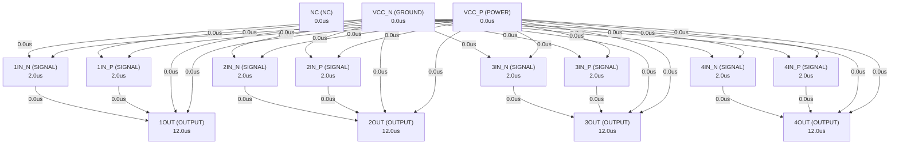

# Autonomous AI Analog Circuit Synthesis & Verification Report
**Target IC:** `LM324` | **Subcircuit:** `LM324`
**Overall Datasheet Specification Pass Rate (among measured specs):** `50.5%`
**Measurement Coverage (measured / testable specs):** `78.1%`

## 1. Executive Summary
- **IC Category:** Quadruple Operational Amplifiers
- **Total Datasheet Specifications Extracted:** 195
- **Design Iterations Required:** 1
- **Synthesized Netlist Location:** `/mnt/d/edai_jiyun2/edai/runs/20261125_174437_lm324/harness/LM324_FINAL_HERMES_HARNESS2.cir`

## 2. Port Dependency Graph (PDG) Scheduling
Topological activation sequence derived from physical pin roles:
| Pin Name | Physical Role | Direction | Activation Time (us) |
| :--- | :--- | :--- | :--- |
| `1IN_N` | `SIGNAL` | `INPUT` | 2.00 us |
| `1IN_P` | `SIGNAL` | `INPUT` | 2.00 us |
| `1OUT` | `OUTPUT` | `OUTPUT` | 12.00 us |
| `2IN_N` | `SIGNAL` | `INPUT` | 2.00 us |
| `2IN_P` | `SIGNAL` | `INPUT` | 2.00 us |
| `2OUT` | `OUTPUT` | `OUTPUT` | 12.00 us |
| `3IN_N` | `SIGNAL` | `INPUT` | 2.00 us |
| `3IN_P` | `SIGNAL` | `INPUT` | 2.00 us |
| `3OUT` | `OUTPUT` | `OUTPUT` | 12.00 us |
| `4IN_N` | `SIGNAL` | `INPUT` | 2.00 us |
| `4IN_P` | `SIGNAL` | `INPUT` | 2.00 us |
| `4OUT` | `OUTPUT` | `OUTPUT` | 12.00 us |
| `NC` | `NC` | `NC` | 0.00 us |
| `VCC_N` | `GROUND` | `—` | 0.00 us |
| `VCC_P` | `POWER` | `—` | 0.00 us |

### 2.1 Port Dependency Graph Topology


## 3. Specification Verification & SymPy Oracle Audit
Detailed verification results evaluated against SymPy interval constraints:
| Parameter | Min Target | Typ Target | Max Target | Measured Value | Unit | Status |
| :--- | :--- | :--- | :--- | :--- | :--- | :--- |
| `VCC` | - | - | - | **N/A** | V | ❌ FAIL |
| `VCC` | - | - | - | **N/A** | V | ❌ FAIL |
| `VCC` | - | - | - | **N/A** | V | ❌ FAIL |
| `VID` | - | - | - | **N/A** | V | ❌ FAIL |
| `VID` | - | - | - | **N/A** | V | ❌ FAIL |
| `VID` | - | - | - | **N/A** | V | ❌ FAIL |
| `VI` | - | - | - | **N/A** | V | ❌ FAIL |
| `VI` | - | - | - | **N/A** | V | ❌ FAIL |
| `VI` | - | - | - | **N/A** | V | ❌ FAIL |
| `t_short` | - | - | - | **N/A** |  | ❌ FAIL |
| `t_short` | - | - | - | **N/A** |  | ❌ FAIL |
| `t_short` | - | - | - | **N/A** |  | ❌ FAIL |
| `TJ` | - | - | - | **N/A** | °C | ❌ FAIL |
| `T_case_60s` | - | - | - | **N/A** | °C | ❌ FAIL |
| `T_lead_60s` | - | - | - | **N/A** | °C | ❌ FAIL |
| `T_stg` | - | - | - | **N/A** | °C | ❌ FAIL |
| `V_ESD_HBM` | - | - | - | **N/A** |  | ❌ FAIL |
| `V_ESD_CDM` | - | - | - | **N/A** | V | ❌ FAIL |
| `V_ESD_HBM` | - | - | - | **N/A** |  | ❌ FAIL |
| `V_ESD_CDM` | - | - | - | **N/A** | V | ❌ FAIL |
| `VCC` | - | - | - | **N/A** | V | ❌ FAIL |
| `VCM` | - | - | - | **N/A** | V | ❌ FAIL |
| `TA` | - | - | - | **N/A** | °C | ❌ FAIL |
| `TA` | - | - | - | **N/A** | °C | ❌ FAIL |
| `TA` | - | - | - | **N/A** | °C | ❌ FAIL |
| `TA` | - | - | - | **N/A** | °C | ❌ FAIL |
| `TA` | - | - | - | **N/A** | °C | ❌ FAIL |
| `RβJA` | - | - | - | **N/A** | °C/W | ❌ FAIL |
| `RβJC(top)` | - | - | - | **N/A** | °C/W | ❌ FAIL |
| `RβJB` | - | - | - | **N/A** | °C/W | ❌ FAIL |
| `ΨJT` | - | - | - | **N/A** | °C/W | ❌ FAIL |
| `ΨJB` | - | - | - | **N/A** | °C/W | ❌ FAIL |
| `RβJC(bot)` | - | - | - | **N/A** | °C/W | ❌ FAIL |
| `VOS` | -0.0006 | - | 0.003 | **2.1e-05** | V | ✅ PASS |
| `VOS` | -0.004 | - | - | **2.1e-05** | V | ✅ PASS |
| `VOS` | -0.0003 | - | 0.002 | **2.1e-05** | V | ✅ PASS |
| `dVOS/dT` | - | - | - | **N/A** | μV/°C | ❌ FAIL |
| `PSRR` | - | - | - | **2.1e-05** | V | ❌ FAIL |
| `Channel separation` | - | - | - | **N/A** | dB | ❌ FAIL |
| `VCM` | - | - | - | **N/A** | V | ❌ FAIL |
| `VCM` | - | - | - | **N/A** | V | ❌ FAIL |
| `CMRR` | 70 | 80 | - | **111.2** | dB | ✅ PASS |
| `CMRR` | 65 | 80 | - | **111.2** | dB | ✅ PASS |
| `IB` | -1e-08 | - | -3.5e-08 | **2.585e-19** | A | ✅ PASS |
| `IB` | - | - | -6e-08 | **2.585e-19** | A | ✅ PASS |
| `dlOS/dT` | - | - | - | **N/A** | pA/°C | ❌ FAIL |
| `IOS` | -5e-10 | - | 4e-09 | **5.159e-19** | A | ✅ PASS |
| `IOS` | - | - | -5e-09 | **5.159e-19** | A | ✅ PASS |
| `EN` | - | - | - | **N/A** | μVPP | ❌ FAIL |
| `eN` | 35 | - | - | **347** | nV/rtHz | ✅ PASS |
| `ZID` | - | - | - | **N/A** | MΩ | ❌ FAIL |
| `ZID` | - | - | - | **N/A** | pF | ❌ FAIL |
| `ZICM` | - | - | - | **N/A** | GΩ | ❌ FAIL |
| `ZICM` | - | - | - | **N/A** | pF | ❌ FAIL |
| `AOL` | 93.98 | 100 | - | **90.29** | dB | ❌ FAIL |
| `AOL` | 87.96 | - | - | **90.29** | dB | ✅ PASS |
| `GBW` | 1.2e+06 | - | - | **1.641e+07** | Hz | ✅ PASS |
| `SR` | 0.5 | - | - | **13.64** | V/us | ✅ PASS |
| `Θm` | 56 | - | - | **68.56** | deg | ✅ PASS |
| `tS` | - | - | - | **N/A** | μs | ❌ FAIL |
| `tS` | - | - | - | **N/A** | us | ❌ FAIL |
| `THD+N` | - | - | - | **N/A** | % | ❌ FAIL |
| `VO` | 1.35 | 1.5 | 1.5 | **0.004974** | V | ❌ FAIL |
| `VO` | 1.4 | 1.6 | 1.6 | **0.1535** | V | ❌ FAIL |
| `VO` | 1.5 | 1.75 | 1.75 | **1.953** | V | ❌ FAIL |
| `VO` | 0.1 | 0.15 | 0.15 | **0.006939** | V | ❌ FAIL |
| `VO` | 0.75 | 1 | 1 | **0.0125** | V | ❌ FAIL |
| `VO` | 0.005 | 0.02 | 0.02 | **0.006642** | V | ✅ PASS |
| `IO` | -0.02 | -0.03 | - | **0.001135** | A | ❌ FAIL |
| `IO` | -0.01 | - | - | **0.001135** | A | ❌ FAIL |
| `IO` | 0.01 | 0.02 | - | **0.1501** | A | ✅ PASS |
| `IO` | 0.005 | - | - | **0.1501** | A | ✅ PASS |
| `IO` | 5e-05 | 8.5e-05 | 8.5e-05 | **0.00113** | A | ❌ FAIL |
| `Isc` | -0.04 | - | 0.04 | **0.001101** | A | ✅ PASS |
| `C₂LOAD` | - | - | - | **N/A** | pF | ❌ FAIL |
| `R₂O` | - | - | - | **N/A** | Ω | ❌ FAIL |
| `IQ` | 0.00024 | - | 0.0003 | **0.001186** | A | ❌ FAIL |
| `IQ` | 0.00035 | - | 0.00075 | **0.001186** | A | ❌ FAIL |
| `VOS` | -0.0006 | 0.003 | - | **2.1e-05** | V | ✅ PASS |
| `VOS` | - | 0.004 | - | **2.1e-05** | V | ✅ PASS |
| `VOS` | 0.0003 | 0.002 | 0.0025 | **2.1e-05** | V | ✅ PASS |
| `dVOS/dT` | - | - | - | **N/A** | μV/°C | ❌ FAIL |
| `PSRR` | - | - | - | **2.1e-05** | V | ❌ FAIL |
| `Channel separation` | - | - | - | **N/A** | dB | ❌ FAIL |
| `VCM` | - | - | - | **N/A** | V | ❌ FAIL |
| `VCM` | - | - | - | **N/A** | V | ❌ FAIL |
| `CMRR` | 70 | 80 | - | **111.2** | dB | ✅ PASS |
| `CMRR` | 65 | 80 | - | **111.2** | dB | ✅ PASS |
| `IB` | -1e-08 | -3.5e-08 | - | **2.585e-19** | A | ✅ PASS |
| `IB` | - | - | -6e-08 | **2.585e-19** | A | ✅ PASS |
| `dIB/dT` | - | - | - | **N/A** | pA/°C | ❌ FAIL |
| `IOS` | -5e-10 | 4e-09 | - | **5.159e-19** | A | ✅ PASS |
| `IOS` | - | - | 5e-09 | **5.159e-19** | A | ✅ PASS |
| `dIOS/dT` | - | - | - | **N/A** | pA/°C | ❌ FAIL |
| `EN` | - | - | - | **N/A** | μVPP | ❌ FAIL |
| `eN` | 35 | - | - | **347** | nV/rtHz | ✅ PASS |
| `ZID` | - | - | - | **N/A** | pF | ❌ FAIL |
| `ZICM` | - | - | - | **N/A** | pF | ❌ FAIL |
| `AOL` | 93.98 | 100 | - | **90.29** | dB | ❌ FAIL |
| `GBW` | 1.2e+06 | - | - | **1.641e+07** | Hz | ✅ PASS |
| `VO` | 1.35 | 1.5 | 1.5 | **0.004974** | V | ❌ FAIL |
| `VO` | 1.4 | 1.6 | 1.6 | **0.1535** | V | ❌ FAIL |
| `VO` | 1.5 | 1.75 | 1.75 | **1.953** | V | ❌ FAIL |
| `VO` | 0.1 | 0.15 | 0.15 | **0.004974** | V | ❌ FAIL |
| `VO` | 0.75 | 1 | 1 | **0.1535** | V | ❌ FAIL |
| `VO` | 0.005 | 0.02 | 0.02 | **0.006642** | V | ✅ PASS |
| `IO` | -0.02 | -0.03 | - | **0.001135** | A | ❌ FAIL |
| `IO` | -0.01 | - | - | **0.001135** | A | ❌ FAIL |
| `IO` | 0.01 | 0.02 | - | **0.1501** | A | ✅ PASS |
| `IO` | 0.005 | - | - | **0.1501** | A | ✅ PASS |
| `IO` | 5e-05 | 8.5e-05 | 8.5e-05 | **0.00113** | A | ❌ FAIL |
| `Isc` | -0.04 | - | 0.06 | **0.001101** | A | ✅ PASS |
| `CLOAD` | - | - | - | **N/A** | pF | ❌ FAIL |
| `RO` | - | - | - | **N/A** | Ω | ❌ FAIL |
| `IQ` | - | 0.00024 | 0.0003 | **0.001186** | A | ❌ FAIL |
| `IQ` | 0.00075 | - | - | **0.001186** | A | ✅ PASS |
| `VIO` | - | 0.003 | 0.005 | **2.1e-05** | V | ✅ PASS |
| `PARAM_117` | - | - | - | **N/A** | mV | ❌ FAIL |
| `IIO` | - | 2e-09 | 3e-08 | **5.159e-19** | A | ✅ PASS |
| `PARAM_119` | - | - | - | **N/A** | nA | ❌ FAIL |
| `IIB` | -2e-08 | -1.5e-07 | -2e-08 | **2.585e-19** | A | ✅ PASS |
| `PARAM_121` | - | - | - | **N/A** | nA | ❌ FAIL |
| `VICR` | - | - | - | **N/A** | V | ❌ FAIL |
| `PARAM_123` | - | - | - | **N/A** | V | ❌ FAIL |
| `VOH` | - | - | - | **0.3883** | V | ❌ FAIL |
| `PARAM_125` | - | - | - | **N/A** | V | ❌ FAIL |
| `PARAM_126` | - | - | - | **N/A** | V | ❌ FAIL |
| `VOL` | - | 0.005 | 0.02 | **0.02616** | V | ❌ FAIL |
| `AVD` | 93.98 | 100 | - | **80.76** | dB | ❌ FAIL |
| `PARAM_129` | - | - | - | **N/A** | V/mV | ❌ FAIL |
| `CMRR` | 70 | 80 | - | **111.2** | dB | ✅ PASS |
| `kSVR` | 65 | 100 | - | **115.9** | dB | ✅ PASS |
| `VOI/ VO2` | - | - | - | **N/A** | dB | ❌ FAIL |
| `IO` | -0.02 | -0.03 | -0.06 | **0.001101** | A | ❌ FAIL |
| `PARAM_134` | - | - | - | **N/A** | mA | ❌ FAIL |
| `IO` | 0.01 | 0.02 | - | **0.001101** | A | ❌ FAIL |
| `PARAM_136` | - | - | - | **N/A** | mA | ❌ FAIL |
| `PARAM_137` | - | - | - | **N/A** | μA | ❌ FAIL |
| `IOS` | - | - | 0.04 | **5.159e-19** | A | ✅ PASS |
| `ICC` | - | 0.0007 | 0.0012 | **0.001186** | A | ✅ PASS |
| `PARAM_140` | - | - | - | **N/A** | mA | ❌ FAIL |
| `VIO` | - | - | - | **2.1e-05** | V | ❌ FAIL |
| `VIO` | - | - | - | **2.1e-05** | V | ❌ FAIL |
| `VIO` | - | - | - | **2.1e-05** | V | ❌ FAIL |
| `ΔVIO/ΔT` | - | - | - | **N/A** | μV/°C | ❌ FAIL |
| `IIO` | 2e-09 | 5e-08 | 5e-08 | **5.159e-19** | A | ✅ PASS |
| `ΔIIO/ΔT` | - | - | - | **N/A** | null | ❌ FAIL |
| `IIB` | -2e-08 | -2.5e-07 | -2.5e-07 | **2.585e-19** | A | ✅ PASS |
| `IIB` | - | -5e-07 | -5e-07 | **2.585e-19** | A | ✅ PASS |
| `VICR` | - | - | - | **N/A** | V | ❌ FAIL |
| `VICR` | - | - | - | **N/A** | V | ❌ FAIL |
| `VOH` | - | - | - | **0.02616** | V | ❌ FAIL |
| `VOH` | 22 | - | 26 | **0.3883** | V | ❌ FAIL |
| `VOH` | 23 | 24 | 27 | **0.02616** | V | ❌ FAIL |
| `VOL` | - | 0.005 | 0.02 | **0.02616** | V | ❌ FAIL |
| `AVD` | 87.96 | 100 | 100 | **80.76** | dB | ❌ FAIL |
| `AVD` | 83.52 | - | - | **80.76** | dB | ❌ FAIL |
| `CMRR` | 50 | 80 | 80 | **111.2** | dB | ❌ FAIL |
| `kSVR` | 50 | 100 | 100 | **115.9** | dB | ❌ FAIL |
| `VO1/ VO2` | - | - | - | **N/A** | dB | ❌ FAIL |
| `IO` | - | - | - | **0.001101** | A | ❌ FAIL |
| `IO` | - | - | - | **0.001101** | A | ❌ FAIL |
| `IO` | - | - | - | **0.1447** | A | ❌ FAIL |
| `IO` | - | - | - | **0.001101** | A | ❌ FAIL |
| `IO` | - | 3e-05 | 1.2e-05 | **0.001101** | A | ❌ FAIL |
| `IO` | - | 4e-05 | 4e-05 | **0.001101** | A | ❌ FAIL |
| `IOS` | - | - | - | **5.159e-19** | A | ❌ FAIL |
| `IOS` | - | - | - | **5.159e-19** | A | ❌ FAIL |
| `ICC` | - | - | - | **0.001186** | A | ❌ FAIL |
| `ICC` | - | - | - | **0.001186** | A | ❌ FAIL |
| `VIO` | - | - | - | **2.1e-05** | V | ❌ FAIL |
| `VIO` | - | - | - | **2.1e-05** | V | ❌ FAIL |
| `IIO` | - | - | - | **5.159e-19** | A | ❌ FAIL |
| `IIO` | - | - | - | **5.159e-19** | A | ❌ FAIL |
| `IIB` | -1.5e-08 | - | -8e-08 | **2.585e-19** | A | ✅ PASS |
| `IIB` | -2e-07 | - | - | **2.585e-19** | A | ✅ PASS |
| `VICR` | - | - | - | **N/A** | V | ❌ FAIL |
| `VICR` | - | - | - | **N/A** | V | ❌ FAIL |
| `VOH` | 26 | - | - | **0.3883** | V | ❌ FAIL |
| `VOH` | 27 | - | 28 | **0.02616** | V | ❌ FAIL |
| `VOL` | - | 0.005 | 0.02 | **0.02616** | V | ❌ FAIL |
| `AVD` | - | - | - | **80.76** | dB | ❌ FAIL |
| `AVD` | - | - | - | **80.76** | dB | ❌ FAIL |
| `CMRR` | 65 | - | 80 | **111.2** | dB | ❌ FAIL |
| `kSVR` | 65 | - | 100 | **115.9** | dB | ❌ FAIL |
| `VO1/VO2` | - | - | - | **N/A** | dB | ❌ FAIL |
| `IO` | - | - | - | **0.001101** | A | ❌ FAIL |
| `IO` | - | - | - | **0.001101** | A | ❌ FAIL |
| `IO` | 1.2e-05 | - | 3e-05 | **0.001101** | A | ❌ FAIL |
| `IOS` | - | - | - | **5.159e-19** | A | ❌ FAIL |
| `Icc` | - | 0.0007 | 0.0012 | **0.001186** | A | ✅ PASS |
| `Icc` | - | 0.0014 | 0.003 | **0.001186** | A | ✅ PASS |
| `SR` | - | - | - | **1.561e+07** | Hz | ❌ FAIL |
| `B1` | - | 1.2e+06 | - | **1.641e+07** | Hz | ❌ FAIL |
| `Vn` | - | - | - | **N/A** | nV/√Hz | ❌ FAIL |
| `Channel separation` | - | 120 | - | **N/A** | dB | ❌ FAIL |
| `THD+N` | 0.001 | - | - | **N/A** | % | ❌ FAIL |
| `Channel separation` | - | 120 | - | **N/A** | dB | ❌ FAIL |
| `VOI/ VO2` | - | 120 | - | **N/A** | dB | ❌ FAIL |
| `VO1/ VO2` | - | 120 | 120 | **N/A** | dB | ❌ FAIL |
| `VO1/VO2` | - | 120 | - | **N/A** | dB | ❌ FAIL |

## 4. Closed-Loop Iteration History & Root Cause Analysis
| Iteration | Pass Rate | Passed Specs | Failed Specs | Architecture Notes |
| :--- | :--- | :--- | :--- | :--- |
| Iteration 1 | 50.5% | 48 | 47 | Hermes Autonomous Synthesis (Workspace: /mnt/d/edai_jiyun2/edai/runs/20261125_17... |

### 4.1 Loop 1 Detailed Audit
- **Pass Rate**: `50.5%` (48/95 specs passed)

**Shortfall Audit (미달 원인 분석):**
- None (All specifications and compilation checks passed).

**Improvement Actions (개선 및 수정 사항):**
- Hermes Agent Turn 1: Executed tools ['edai_seed_verify']

## 5. Synthesized SPICE Netlist Architecture
Netlist file: `/mnt/d/edai_jiyun2/edai/runs/20261125_174437_lm324/harness/LM324_FINAL_HERMES_HARNESS2.cir`
```spice


* Default Physical Device Models for AI Analog Synthesis

.model NMOS NMOS (LEVEL=1 VTO=0.7 KP=120u GAMMA=0.4 PHI=0.6 LAMBDA=0.02 TOX=10n CJ=2e-4 CJSW=1e-10 CGDO=2e-10 CGSO=2e-10)

.model PMOS PMOS (LEVEL=1 VTO=-0.7 KP=40u GAMMA=0.4 PHI=0.6 LAMBDA=0.02 TOX=10n CJ=2e-4 CJSW=1e-10 CGDO=2e-10 CGSO=2e-10)

.model QNPN NPN (IS=1e-14 BF=150 VAF=100 IKF=0.1 ISE=1e-14 NE=1.5 BR=1 VAR=100 TF=0.3n TR=10n CJE=2p CJC=1p VJC=0.75 MJC=0.33)

.model QPNP PNP (IS=1e-14 BF=80 VAF=80 IKF=0.1 ISE=1e-14 NE=1.5 BR=1 VAR=80 TF=0.5n TR=20n CJE=2p CJC=1.5p VJC=0.75 MJC=0.33)

.model D1N4148 D (IS=2.52n RS=0.568 N=1.752 CJO=4p VJ=0.5 M=0.333 BV=100 IBV=100u TT=4n)

.model D_ESD D (IS=1e-15 RS=10 CJO=1p BV=50)


.include "gf180_6v_typical.lib"

.subckt LM324 1IN_N 1IN_P 1OUT 2IN_N 2IN_P 2OUT 3IN_N 3IN_P 3OUT 4IN_N 4IN_P 4OUT NC VCC_N VCC_P
MPM1 1OUT VB2 VCC_P VCC_P pfet_06v0_bsim0 w=98.2u l=2u m=35
MPM3 N2 VB2 VCC_P VCC_P pfet_06v0_bsim0 w=68.7u l=2u
MPM4 N3 1IN_P N2 VCC_P pfet_06v0_bsim0 w=43.4u l=1u
MPM5 N4 1IN_N N2 VCC_P pfet_06v0_bsim0 w=43.4u l=1u
MNM2 1OUT N3 VCC_N VCC_N nfet_06v0_bsim0 w=88u l=1u m=7
MNM3 N3_NM3 N4 VCC_N VCC_N nfet_06v0_bsim0 w=6.03u l=1u
MNM4 N4_NM4 N4 VCC_N VCC_N nfet_06v0_bsim0 w=6.03u l=1u
C1 1OUT N3 1p
MNMC1 N3 VBCN N3_NM3 VCC_N nfet_06v0_bsim0 w=9.32u l=1u
MNMC2 N4 VBCN N4_NM4 VCC_N nfet_06v0_bsim0 w=9.32u l=1u
MPMB1 VB2 VB2 VCC_P VCC_P pfet_06v0_bsim0 w=68.7u l=2u
MNMF1 VB2 REF_NB VCC_N VCC_N nfet_06v0_bsim0 w=24u l=2u
MNMB2 VBCN VBCN VBCN_S1 VCC_N nfet_06v0_bsim0 w=14.9u l=2u
RBCVBCN VBCN_S1 VCC_N 28174.6
MPMF2 VBCN REF_PB VCC_P VCC_P pfet_06v0_bsim0 w=58.6u l=2u m=2
MREF_MN1 REF_NB REF_NB VCC_N VCC_N nfet_06v0_bsim0 w=12u l=2u
MREF_MN2 REF_PB REF_NB REF_NS VCC_N nfet_06v0_bsim0 w=48u l=2u
RREF_S REF_NS VCC_N 8353.6
MREF_MP3 REF_PB REF_PB VCC_P VCC_P pfet_06v0_bsim0 w=58.6u l=2u
MREF_MP4 REF_NB REF_PB VCC_P VCC_P pfet_06v0_bsim0 w=58.6u l=2u
MREF_MS1 REF_SX VCC_N VCC_P VCC_P pfet_06v0_bsim0 w=0.5u l=20u
MREF_MS2 REF_PB REF_SX VCC_N VCC_N nfet_06v0_bsim0 w=2u l=1u
MREF_MS3 REF_SX REF_NB VCC_N VCC_N nfet_06v0_bsim0 w=5u l=1u
MPM1_2 2OUT VB2_2 VCC_P VCC_P pfet_06v0_bsim0 w=98.2u l=2u m=35
MPM3_2 N2_2 VB2_2 VCC_P VCC_P pfet_06v0_bsim0 w=68.7u l=2u
MPM4_2 N3_2 2IN_P N2_2 VCC_P pfet_06v0_bsim0 w=43.4u l=1u
MPM5_2 N4_2 2IN_N N2_2 VCC_P pfet_06v0_bsim0 w=43.4u l=1u
MNM2_2 2OUT N3_2 VCC_N VCC_N nfet_06v0_bsim0 w=88u l=1u m=7
MNM3_2 N3_NM3_2 N4_2 VCC_N VCC_N nfet_06v0_bsim0 w=6.03u l=1u
MNM4_2 N4_NM4_2 N4_2 VCC_N VCC_N nfet_06v0_bsim0 w=6.03u l=1u
C1_2 2OUT N3_2 1p
MNMC1_2 N3_2 VBCN_2 N3_NM3_2 VCC_N nfet_06v0_bsim0 w=9.32u l=1u
MNMC2_2 N4_2 VBCN_2 N4_NM4_2 VCC_N nfet_06v0_bsim0 w=9.32u l=1u
MPMB1_2 VB2_2 VB2_2 VCC_P VCC_P pfet_06v0_bsim0 w=68.7u l=2u
MNMF1_2 VB2_2 REF_NB_2 VCC_N VCC_N nfet_06v0_bsim0 w=24u l=2u
MNMB2_2 VBCN_2 VBCN_2 VBCN_S1_2 VCC_N nfet_06v0_bsim0 w=14.9u l=2u
RBCVBCN_2 VBCN_S1_2 VCC_N 28174.6
MPMF2_2 VBCN_2 REF_PB_2 VCC_P VCC_P pfet_06v0_bsim0 w=58.6u l=2u m=2
MREF_MN1_2 REF_NB_2 REF_NB_2 VCC_N VCC_N nfet_06v0_bsim0 w=12u l=2u
MREF_MN2_2 REF_PB_2 REF_NB_2 REF_NS_2 VCC_N nfet_06v0_bsim0 w=48u l=2u
RREF_S_2 REF_NS_2 VCC_N 8353.6
MREF_MP3_2 REF_PB_2 REF_PB_2 VCC_P VCC_P pfet_06v0_bsim0 w=58.6u l=2u
MREF_MP4_2 REF_NB_2 REF_PB_2 VCC_P VCC_P pfet_06v0_bsim0 w=58.6u l=2u
MREF_MS1_2 REF_SX_2 VCC_N VCC_P VCC_P pfet_06v0_bsim0 w=0.5u l=20u
MREF_MS2_2 REF_PB_2 REF_SX_2 VCC_N VCC_N nfet_06v0_bsim0 w=2u l=1u
MREF_MS3_2 REF_SX_2 REF_NB_2 VCC_N VCC_N nfet_06v0_bsim0 w=5u l=1u
MPM1_3 3OUT VB2_3 VCC_P VCC_P pfet_06v0_bsim0 w=98.2u l=2u m=35
MPM3_3 N2_3 VB2_3 VCC_P VCC_P pfet_06v0_bsim0 w=68.7u l=2u
MPM4_3 N3_3 3IN_P N2_3 VCC_P pfet_06v0_bsim0 w=43.4u l=1u
MPM5_3 N4_3 3IN_N N2_3 VCC_P pfet_06v0_bsim0 w=43.4u l=1u
MNM2_3 3OUT N3_3 VCC_N VCC_N nfet_06v0_bsim0 w=88u l=1u m=7
MNM3_3 N3_NM3_3 N4_3 VCC_N VCC_N nfet_06v0_bsim0 w=6.03u l=1u
MNM4_3 N4_NM4_3 N4_3 VCC_N VCC_N nfet_06v0_bsim0 w=6.03u l=1u
C1_3 3OUT N3_3 1p
MNMC1_3 N3_3 VBCN_3 N3_NM3_3 VCC_N nfet_06v0_bsim0 w=9.32u l=1u
MNMC2_3 N4_3 VBCN_3 N4_NM4_3 VCC_N nfet_06v0_bsim0 w=9.32u l=1u
MPMB1_3 VB2_3 VB2_3 VCC_P VCC_P pfet_06v0_bsim0 w=68.7u l=2u
MNMF1_3 VB2_3 REF_NB_3 VCC_N VCC_N nfet_06v0_bsim0 w=24u l=2u
MNMB2_3 VBCN_3 VBCN_3 VBCN_S1_3 VCC_N nfet_06v0_bsim0 w=14.9u l=2u
RBCVBCN_3 VBCN_S1_3 VCC_N 28174.6
MPMF2_3 VBCN_3 REF_PB_3 VCC_P VCC_P pfet_06v0_bsim0 w=58.6u l=2u m=2
MREF_MN1_3 REF_NB_3 REF_NB_3 VCC_N VCC_N nfet_06v0_bsim0 w=12u l=2u
MREF_MN2_3 REF_PB_3 REF_NB_3 REF_NS_3 VCC_N nfet_06v0_bsim0 w=48u l=2u
RREF_S_3 REF_NS_3 VCC_N 8353.6
MREF_MP3_3 REF_PB_3 REF_PB_3 VCC_P VCC_P pfet_06v0_bsim0 w=58.6u l=2u
MREF_MP4_3 REF_NB_3 REF_PB_3 VCC_P VCC_P pfet_06v0_bsim0 w=58.6u l=2u
MREF_MS1_3 REF_SX_3 VCC_N VCC_P VCC_P pfet_06v0_bsim0 w=0.5u l=20u
MREF_MS2_3 REF_PB_3 REF_SX_3 VCC_N VCC_N nfet_06v0_bsim0 w=2u l=1u
MREF_MS3_3 REF_SX_3 REF_NB_3 VCC_N VCC_N nfet_06v0_bsim0 w=5u l=1u
MPM1_4 4OUT VB2_4 VCC_P VCC_P pfet_06v0_bsim0 w=98.2u l=2u m=35
MPM3_4 N2_4 VB2_4 VCC_P VCC_P pfet_06v0_bsim0 w=68.7u l=2u
MPM4_4 N3_4 4IN_P N2_4 VCC_P pfet_06v0_bsim0 w=43.4u l=1u
MPM5_4 N4_4 4IN_N N2_4 VCC_P pfet_06v0_bsim0 w=43.4u l=1u
MNM2_4 4OUT N3_4 VCC_N VCC_N nfet_06v0_bsim0 w=88u l=1u m=7
MNM3_4 N3_NM3_4 N4_4 VCC_N VCC_N nfet_06v0_bsim0 w=6.03u l=1u
MNM4_4 N4_NM4_4 N4_4 VCC_N VCC_N nfet_06v0_bsim0 w=6.03u l=1u
C1_4 4OUT N3_4 1p
MNMC1_4 N3_4 VBCN_4 N3_NM3_4 VCC_N nfet_06v0_bsim0 w=9.32u l=1u
MNMC2_4 N4_4 VBCN_4 N4_NM4_4 VCC_N nfet_06v0_bsim0 w=9.32u l=1u
MPMB1_4 VB2_4 VB2_4 VCC_P VCC_P pfet_06v0_bsim0 w=68.7u l=2u
MNMF1_4 VB2_4 REF_NB_4 VCC_N VCC_N nfet_06v0_bsim0 w=24u l=2u
MNMB2_4 VBCN_4 VBCN_4 VBCN_S1_4 VCC_N nfet_06v0_bsim0 w=14.9u l=2u
RBCVBCN_4 VBCN_S1_4 VCC_N 28174.6
MPMF2_4 VBCN_4 REF_PB_4 VCC_P VCC_P pfet_06v0_bsim0 w=58.6u l=2u m=2
MREF_MN1_4 REF_NB_4 REF_NB_4 VCC_N VCC_N nfet_06v0_bsim0 w=12u l=2u
MREF_MN2_4 REF_PB_4 REF_NB_4 REF_NS_4 VCC_N nfet_06v0_bsim0 w=48u l=2u
RREF_S_4 REF_NS_4 VCC_N 8353.6
MREF_MP3_4 REF_PB_4 REF_PB_4 VCC_P VCC_P pfet_06v0_bsim0 w=58.6u l=2u
MREF_MP4_4 REF_NB_4 REF_PB_4 VCC_P VCC_P pfet_06v0_bsim0 w=58.6u l=2u
MREF_MS1_4 REF_SX_4 VCC_N VCC_P VCC_P pfet_06v0_bsim0 w=0.5u l=20u
MREF_MS2_4 REF_PB_4 REF_SX_4 VCC_N VCC_N nfet_06v0_bsim0 w=2u l=1u
MREF_MS3_4 REF_SX_4 REF_NB_4 VCC_N VCC_N nfet_06v0_bsim0 w=5u l=1u
.ends LM324
```